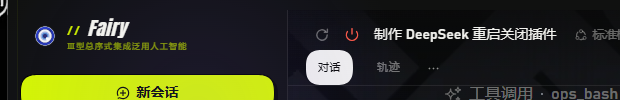

# dsh-power-control

Restart or shut down DeepSeek Harness from two small buttons in the session header — placed immediately to the right of the sidebar toggle.



深色/浅色主题跟随 DSH 的 alias token，不写死颜色。

## 安装

这是一个 DSH bundle（`dsh.bundle.patch` + `dsh.client`）。两种装法：

```powershell
# 方式一：Plugins → Add plugin → 选择本目录
# 方式二：本机开发时用 link 装进 profile
```

安装后新开一个会话即可看到按钮；如果按钮没出现，检查 Plugins 里 `dsh-power-control` 这一行是否 enabled。

## 结构

```
package.json       # bundle 清单：patch + client + locale + icon
cordis.patch.yml   # 插入一行插件
index.js           # Host：注册 /dsh-power-control/api/* 路由，派生分离脚本执行动作
client.js          # Client：会话标题栏最左侧的两个按钮 + 确认框 + 状态遮罩
locale/zh.json     # 插件管理里显示的标题/描述/详情
locale/en.json
docs/DETAIL.md     # 插件详情页正文
icon.svg           # 原创图标
```

## 行为

- **重启**：确认 → POST `/restart` → 宿主启动分离脚本 → 4～5 秒内程序退出并重新启动 → 页面轮询 `/status`，连上后自动 `location.reload()`。
- **关闭**：确认 → POST `/shutdown` → 分离脚本先 `CloseMainWindow()`，4 秒后强杀兜底 → 页面显示“已退出”。

动作全部由宿主完成；浏览器端只发一条请求，不需要额外权限。

## 开发

- 测试：`npm test`（等价于 `node test/host-smoke.mjs && node test/client-smoke.mjs`）。
  两条都是无副作用的冒烟测试：Host 侧用假 cordis 校验路由/鉴权/脚本内容，Client 侧用假 loader 校验词典与 slot 注册。
- 只读自检：启动 DSH 后访问 `GET /dsh-power-control/api/status`（需要 GUI 的登录态），
  返回 `pid`、`execPath`、`argv` 以及解析出的启动命令 `launch.exe` / `launch.source`。
- 干跑：`DSH_POWER_CONTROL_DRY=1` 启动 DSH，脚本只写日志不动进程。
- 自定义要拉起的程序：环境变量 `DSH_POWER_CONTROL_EXE`。
- 日志：`%TEMP%\dsh-power-control\`。

## License

MIT
